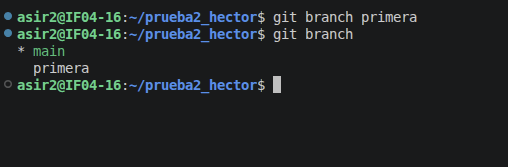
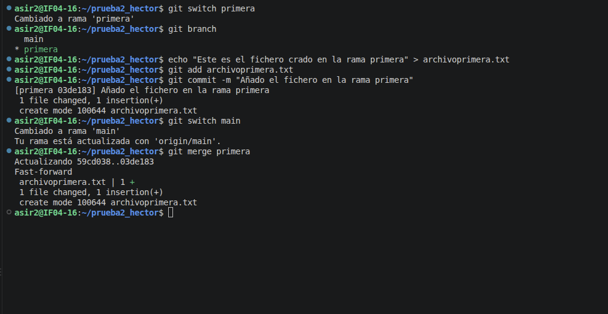
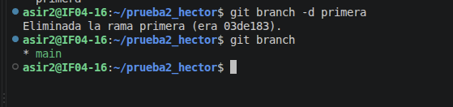
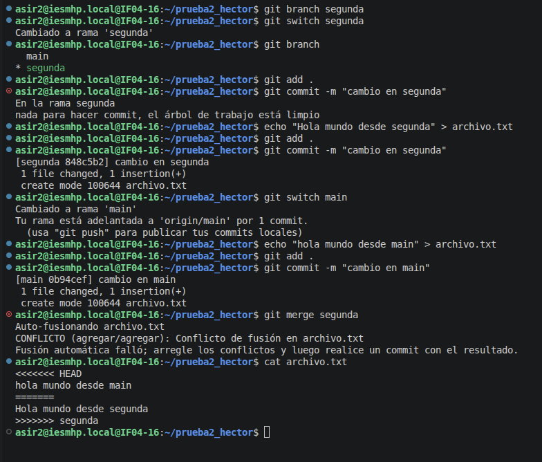
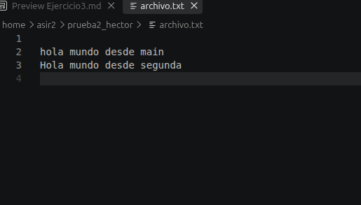
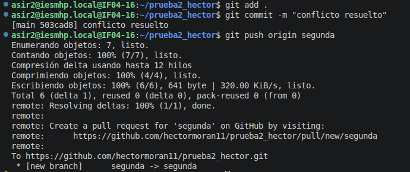
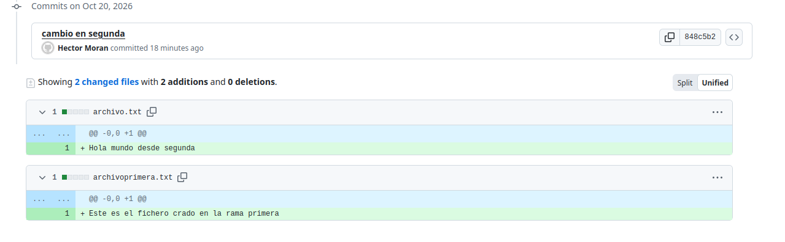

# Ejercicio 3

## 1. Crear la rama primera

Para crear la rama primera en el repositorio local, ejecuto:

`git branch primera`

Para comprobar que se ha creado, utilizo:

`git branch`

Este comando es el que enseña las ramas locales. La rama en la que estás aparece marcada con un asterisco, ahora mismo en mi caso es main.



## 2. Crear un fichero y fusionar la rama primera

Cambio a la rama primera con `git switch primera`

Luego creo un fichero nuevo llamado archivoprimera.txt

Después guardo el fichero y lo añado al repositorio con:

`git add archivoprimera.txt`
`git commit -m "`

Vuelvo a la rama principal y fusiono los cambios con:

`git switch main`
`git merge primera`




### ¿Se ha producido conflicto?

No hay ningún conflicto porque he creado un archivo nuevo en la rama primera, y ese archivo no existe en la rama main. Por eso git puede añadirlo directamente sin tener que resolver ningún cambio.

## 3. Borrar la rama primera

Para borrar la rama primera usamos:

`git branch -d primera`



## 4. Crear la rama segunda y generar un conflicto

Creo la rama llamada segunda y me cambio a ella.

A continuación, modifico un fichero escribiendo una línea en él. Lo añado y hago el commit en la rama segunda:

`git add archivo.txt`  
`git commit -m "cambio en segunda"`

Luego vuelvo a la rama main y modifico **la misma línea del mismo fichero** con un texto diferente para forzar el conflicto:

Al intentar fusionar la rama `segunda` en `main`:

`git merge segunda`

Git detecta un conflicto de fusión.



### Contenido del fichero con el conflicto:

Al abrir el fichero, Git nos muestra las marcas de conflicto:

```
<<<<<<< HEAD
hola mundo desde main
=======
Hola mundo desde segunda
>>>>>>> segunda
```

## 5. Resolver el conflicto

Modifico el fichero, borrando las lineas que empieza por <<<<<<< HEAD, la línea que solo tiene ======= y la línea que termina con >>>>>>> segunda. Dejo solo las líneas que quiero.



Guardo el fichero y ejecuto el add y el commit.

Por último, subo la rama segunda al repositorio remoto en GitHub con:

`git push origin segunda`



