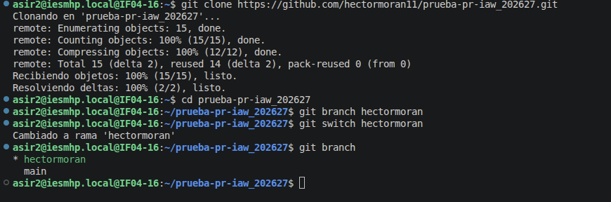
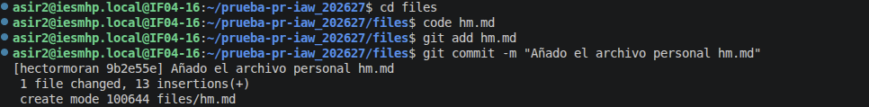
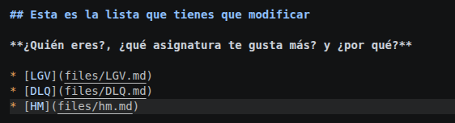
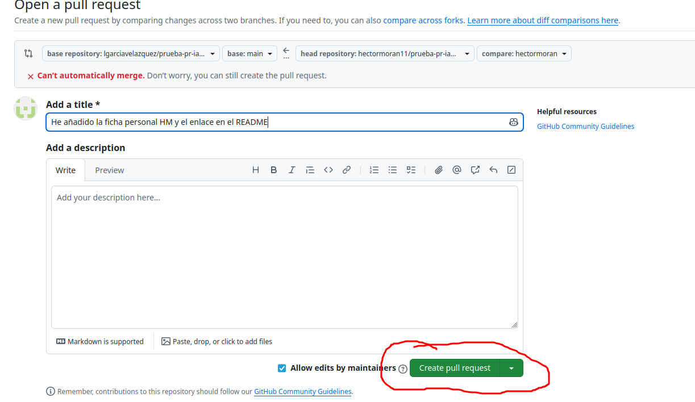

# Ejercicio 4: Colaborar en un proyecto de software libre y Pull Request (PR)?

## 1. Realizar el Fork del repositorio

Para poder colaborar en un proyecto ajeno sin modificar directamente el repositorio principal, entro en el repositorio que quiero y hago clic en el botón **Fork** en la parte superior derecha de GitHub.

Esto crea una copia exacta del repositorio en mi cuenta personal de GitHub.

## 2. Clonar el repositorio y crear una nueva rama

Luego clono mi fork en mi ordenador usando el comando:

`git clone https://github.com/hectormoran11/prueba-pr-iaw_202627.git`

Entro en la carpeta descargada:

`cd prueba-pr-iaw_202627`

Y creo una rama nueva para realizar los cambios y me cambio a ella

`git branch hectormoran`

## 3. Crear el archivo personal y editar el README.md

Dentro del directorio `files/`, creo mi archivo personal `hm.md` con las respuestas a las preguntas utilizando al menos 5 marcas distintas de Markdown.

A continuación, edito el archivo `README.md` principal para añadir un enlace hacia mi nuevo fichero:

`* [HM](files/hm.md)`

Guardo los archivos modificados y hago el add y el commit.

Y subo la nueva rama a mi repositorio remoto en GitHub con:

`git push origin hectormoran`

## 5. Realizar el Pull Request (PR)

Voy a la página web de mi fork en GitHub y pulso en el botón **Compare & pull request**.

Escribo un título explicando los cambios realizados y envío el Pull Request al repositorio original.

Por último, espero a que el propietario acepte el PR y sincronizo el repositorio para recibir los cambios de mis compañeros.

